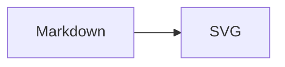

## Words

`@pierre/words` renders Markdown as HTML or ANSI with a WebAssembly Text (WAT)
parser. It supports CommonMark 0.31.2, GFM 0.29, and footnotes. The core has no
runtime dependencies. React and syntax highlighting are optional.

Try the [Words demo](/words) or see the [API Reference](#words-api-reference).

### Installation

<DocsCodeExample {...wordsInstall} />

The package runs in Node.js, browsers, and Cloudflare Workers. Imports select
the runtime loader and initialize WebAssembly. All render calls are synchronous
after import. Normal use needs no `init()` call.

Install `react` for the React component. Install `@pierre/highlights` for the
code plugin. Both are optional peer dependencies. The core entry point loads
neither package.

### Build with agents

Install the
[Words skill](https://github.com/pierrecomputer/pierre/tree/main/skills/words)
to give your agent the API reference and integration recipes:

<DocsCodeExample {...wordsSkill} />

The skill covers the render APIs, code plugins, Mermaid, math, and CJK emphasis.
Agents can also read the [plain-text docs](/llms-full.txt).

### React

Pass the full Markdown string as `children` on every update. Set `isAnimating`
to `true` while text arrives, then set it to `false` after the final update.

<DocsCodeExample {...wordsReact} />

While the stream is active, Words completes unfinished emphasis, code, and links
for display. It hides unfinished images. The final update renders the source
without these repairs.

Import `@pierre/words/styles.css` for Markdown styles, code controls, fades, and
the caret. Fades apply to new text only during an active stream. Reduced motion
or a zero duration disables fades.

| Prop                                 | Default       | Behavior                                                                 |
| ------------------------------------ | ------------- | ------------------------------------------------------------------------ |
| `children`                           | `''`          | Full Markdown string.                                                    |
| `mode`                               | `'streaming'` | Use `'static'` for content that never streams.                           |
| `isAnimating`                        | `false`       | Marks the stream active when `mode` is `'streaming'`.                    |
| `parseIncompleteMarkdown`            | `true`        | Repairs unfinished syntax during an active stream.                       |
| `animated`                           | `false`       | Use `true` or `{ animation: 'fadeIn', duration: 180 }` for fades.        |
| `caret`                              | None          | Use `'block'` or `'circle'` during an active stream.                     |
| `onAnimationStart`, `onAnimationEnd` | None          | Callbacks for the stream's active state, separate from individual fades. |

The component also accepts
[renderer options](#words-api-reference-customize-the-output) and standard `div`
attributes, such as `className`. React supplies a unique `idPrefix` by default.
The component supports server output and hydration. Keep the initial source and
options consistent between server and client.

#### Reactive islands

Pass an `islands` registry to mount React components from fenced blocks. The
fence language is `island-NAME`, and the body is a JSON object with a nonempty
string `id`. Keep the id stable and unique in the document so the component
keeps its state across updates. A repeated id shows its fallback.

````md
```island-counter
{"id":"article-votes","label":"Votes"}
```
````

<DocsCodeExample {...wordsIslands} />

`render(data)` validates the data and returns an element, or `null` to show the
source as code. Put hooks in the component it returns. A closed fence shows
`fallback` on the server and mounts on the client while the stream continues. An
open fence is hidden while it streams. Set `pending` to text or to
`{ className, label? }` to show a placeholder. An invalid payload or an
unregistered name renders as code.

Set `inline: true` on an entry to also accept a directive in prose, such as
`:file[inline.wat]{path="src/inline.wat"}`. The component gets the label as
`data.label` and each attribute as a string. Without an explicit `id`, Words
derives one from the directive content. Inline names share the 4,096-byte
`idPrefix` limit.

### DOM rendering

Use `createDomRenderer(root, options)` from `@pierre/words/html` to patch an
existing element as text arrives, without React. Call `connect()` to enable code
controls and animation. The renderer adds `data-markdown="root"` to the
container.

<DocsCodeExample {...wordsDom} />

Pass the full Markdown string to
`update(source, incomplete, active = false, animated = false, caret?)` on each
update. Set `incomplete` to repair unfinished Markdown and `active` to enable
stream behavior such as live code highlighting. On the final call, set both
flags to `false`. Use the optional `animated` and `caret` arguments for the same
[effects as React](#words-react). Call `disconnect()` when you remove the
container to release event listeners and the live highlighter.

### HTML rendering

<span id="words-html-and-dom" />

Use `createHtmlRenderer()` from `@pierre/words/html` to produce HTML strings on
the server or in the browser. It omits raw HTML, except tags listed in
`allowedHtml`, checks URLs, and supports
[hooks and plugins](#words-api-reference-customize-the-output). For a complete
document, call `renderer.render(source, false).html`.

<DocsCodeExample {...wordsHtml} />

For a stream, keep one renderer per document and pass the full Markdown string
to `render(source, incomplete, active = false)` on each update. The flags work
like the [DOM renderer](#words-dom-rendering) flags. Read `html` for the whole
document or read the [incremental fields](#words-stream-rendering) to find what
changed. Call `dispose()` when you finish. To use the Words stylesheet, wrap the
output in an element with `data-markdown="root"`.

#### HTML bytes

<span id="words-html-and-ansi-bytes" />

Use `renderToHtml()` from `@pierre/words` to turn a complete Markdown document
into UTF-8 HTML. The input can be a string, a UTF-8 `Uint8Array`, or an
`ArrayBuffer`.

<DocsCodeExample {...wordsHtmlBytes} />

The returned `Uint8Array` shares WebAssembly memory. Decode it or copy it before
another render can overwrite the bytes or detach the view.

| HTML option   | Default | Behavior                                                        |
| ------------- | ------- | --------------------------------------------------------------- |
| `skipHtml`    | `false` | Omit raw HTML.                                                  |
| `allowedHtml` |         | Keep only these raw HTML tags and attributes.                   |
| `escapeHtml`  | `false` | Show raw HTML as escaped text. Overrides the two options above. |
| `incomplete`  | `false` | Repair common unfinished inline syntax for display.             |
| `frontmatter` | `false` | Parse YAML frontmatter and return `[meta, output]`.             |
| `math`        | `false` | Render [TeX as SVG](#words-math-rendering).                     |
| `cjk`         | `false` | Enable [CJK-friendly emphasis](#words-cjk-support).             |

`renderToHtml()` preserves raw HTML by default. Sanitize output from untrusted
Markdown before inserting it into a page. Links and images still need URL
validation with `skipHtml: true`. Use `createHtmlRenderer()` above when you need
those checks.

<span id="words-html-and-ansi-bytes-frontmatter" />

**YAML frontmatter.** Set `frontmatter: true` on `renderToHtml()` to remove the
initial YAML block from the body and return `[meta, bytes]`.

<DocsCodeExample {...wordsFrontmatter} />

`meta` can be any JSON value. Without frontmatter, it is `null`.
`renderToHtml<T>()` supplies a TypeScript type for the metadata. Validate the
value at runtime before use.

### ANSI rendering

Use `renderToAnsi()` from `@pierre/words` for terminal output. It accepts the
same input types as `renderToHtml()` and returns UTF-8 bytes with ANSI
formatting. Copy the bytes before passing them to an asynchronous writer.

<DocsCodeExample {...wordsAnsi} />

| Option  | Default | Behavior                                                                   |
| ------- | ------- | -------------------------------------------------------------------------- |
| `width` | `0`     | Wrap at this column, up to 4096. Leave it at `0` to let the terminal wrap. |
| `math`  | `false` | Display recognized math as TeX source.                                     |
| `cjk`   | `false` | Enable [CJK-friendly emphasis](#words-cjk-support).                        |

Input control characters become U+FFFD.

### Stream rendering

<span id="words-html-sessions" />

Append each new chunk to the Markdown string and pass the full string on every
update. Use [Markdown in React](#words-react) or the
[DOM renderer](#words-dom-rendering) to update a page as text arrives.

Use `createHtmlSession()` from `@pierre/words` to consume incremental HTML
yourself. Keep one session per document and pass the full source string to
`session.render(source, options)`. Sessions do not accept bytes. Use
`incomplete: true` to repair unfinished syntax in previews. Set it to `false` on
the final update. The `incomplete`, `math`, `cjk`, and `escapeHtml` options all
default to `false`.

<DocsCodeExample {...wordsSession} />

| Field      | Meaning                                           |
| ---------- | ------------------------------------------------- |
| `html`     | Full HTML, assembled on first read.               |
| `stable`   | Completed blocks.                                 |
| `addition` | HTML completed since the previous revision.       |
| `pending`  | HTML that can still change.                       |
| `reset`    | The previous completed prefix is no longer valid. |
| `revision` | Output version.                                   |

If `reset` is true or you skipped a revision, replace the completed HTML with
`stable`. Otherwise, append `addition` once for the new revision. In both cases,
replace the pending part with `pending`. The DOM renderer handles this for you.

Sessions reuse completed blocks. Edits, changes to parser options, and link or
footnote definitions can require a full render. Session results are strings that
stay valid after later calls. Sessions omit raw HTML, except tags listed in
`allowedHtml`, or show it as text with `escapeHtml: true`. They preserve
Markdown URLs. Sanitize the output before inserting untrusted content into a
page.

### Syntax highlighting

Install `@pierre/highlights`, then create the plugin outside the component so
updates reuse it:

<DocsCodeExample {...wordsHighlights} />

Pass a theme object from `@pierre/highlights/themes`, not a theme name. The
plugin accepts `theme` or `themes` and the Highlights HTML theme options. See
[Highlights themes](#highlights-themes).

Unsupported languages render as plain code. To add a language, register a custom
lexer with `registerLanguages()` from `@pierre/highlights`. An open fence uses
an incremental tokenizer. The renderer releases it when the fence closes or
disappears. The same `plugins` object works with the HTML and DOM renderers.

### Mermaid diagrams

Install `pele` and pass its `render` function to `createMermaidPlugin()`. Use
the same `plugins` object with React, `createHtmlRenderer()`, or
`createDomRenderer()`. Pass Pele options as the second argument to the plugin
factory.

<DocsCodeExample {...wordsMermaid} />

Use a `mermaid` fence in the Markdown source.

````md

````

During a stream, the plugin tries to draw the diagram after each complete line.
If Pele cannot parse the new source, the last valid diagram stays visible. The
fence stays hidden until the first diagram appears. If a closed fence fails to
parse, Words shows the source as a code block. The diagram sits in the code
block frame. Its copy and download buttons use the Mermaid source after the
fence closes.

### Math rendering

Set `math` on `<Markdown>` or use `{ math: true }` in the render options. Words
converts TeX to SVG with its built-in renderer. `renderToAnsi()` shows the TeX
source.

```md
Inline math uses single dollars, as in $e^{i\pi} + 1 = 0$.

$$
\frac{a}{b}
$$
```

For inline math, put the expression directly against both `$` delimiters. A
digit immediately after the closing `$` prevents a match. This keeps prices such
as `$5 and $10` as text. For display math, use `$$...$$`, a multi-line `$$`
block without blank lines, or a `math` code fence.

During a stream, inline math stays as text until the closing delimiter. Open
display blocks can show partial formulas.

An app that renders no TeX can import `renderToHtml()`, `renderToAnsi()`, and
`createHtmlSession()` from `@pierre/words/no-math` instead of `@pierre/words`.
Its WebAssembly module is about a third smaller, and the `math` option shows
formulas as code.

### CJK support

Set `cjk` on `<Markdown>` or use `{ cjk: true }` in the render options. This
lets `*`, `**`, and `~~` mark emphasis and strikethrough where punctuation meets
Chinese, Japanese, or Korean text. For example, `**重要。**请阅读。` renders as
`<strong>重要。</strong>请阅读。` inside a paragraph. Use asterisks, not
underscores, for emphasis next to CJK punctuation.

### API reference

| Task                                                  | API                                         | Import from                |
| ----------------------------------------------------- | ------------------------------------------- | -------------------------- |
| [Display Markdown in React](#words-react)             | `Markdown`                                  | `@pierre/words/react`      |
| [Render an HTML string](#words-html-rendering)        | `createHtmlRenderer(options?)`              | `@pierre/words/html`       |
| [Update a DOM container](#words-dom-rendering)        | `createDomRenderer(root, options?)`         | `@pierre/words/html`       |
| [Read incremental updates](#words-stream-rendering)   | `createHtmlSession()`                       | `@pierre/words`            |
| [Render HTML bytes](#words-html-rendering-html-bytes) | `renderToHtml(input, options?)`             | `@pierre/words`            |
| [Write terminal output](#words-ansi-rendering)        | `renderToAnsi(input, options?)`             | `@pierre/words`            |
| [Highlight fenced code](#words-syntax-highlighting)   | `createHighlightsPlugin(options)`           | `@pierre/words/highlights` |
| [Draw Mermaid diagrams](#words-mermaid-diagrams)      | `createMermaidPlugin({ render }, options?)` | `@pierre/words/mermaid`    |

#### Customize the output <span id="words-html-options-and-hooks" />

Pass these options as props to `Markdown` or as an options object to
`createHtmlRenderer()` and `createDomRenderer()`. Use a distinct `idPrefix` for
each document with footnotes on the same page, up to 4096 UTF-8 bytes. On the
HTML string renderer, `configure(next)` replaces the options and clears cached
output by default.

| Option               | Default                     | Behavior                                                                     |
| -------------------- | --------------------------- | ---------------------------------------------------------------------------- |
| `components`         | None                        | Hooks for generated HTML elements.                                           |
| `plugins.code`       | None                        | Code highlighter.                                                            |
| `plugins.mermaid`    | None                        | [Mermaid diagram plugin](#words-mermaid-diagrams).                           |
| `plugins.renderers`  | None                        | Custom code block renderers, selected by language.                           |
| `math`               | `false`                     | Render [TeX as SVG](#words-math-rendering).                                  |
| `cjk`                | `false`                     | Enable [CJK-friendly emphasis](#words-cjk-support).                          |
| `escapeHtml`         | `false`                     | Show raw HTML as escaped text instead of omitting it.                        |
| `controls`           | `true`                      | Code copy and download buttons. Also accepts `{ code: { copy, download } }`. |
| `lineNumbers`        | `true`                      | Code line numbers.                                                           |
| `allowedElements`    | None                        | Allow only these element names.                                              |
| `disallowedElements` | None                        | Remove these element names. Use only one element list.                       |
| `unwrapDisallowed`   | `false`                     | Keep the children of filtered elements.                                      |
| `urlTransform`       | Default URL check           | Transform each `href` or `src` before URL validation.                        |
| `idPrefix`           | Empty, or a unique React id | Prefix generated footnote ids and references.                                |

**Change options.** `createDomRenderer()` also has `configure(next)`. It
reformats completed output only when an option value changes, so inline option
objects stay cheap. New hook and `urlTransform` functions apply to later output.
`Markdown` calls it for you when props change.

**Element hooks.** Map a tag such as `a` or `h2` to a function that takes the
generated HTML string and returns a replacement string. Use `inlineCode` to
target inline code. This example adds CSS classes and removes image URLs.

<DocsCodeExample {...wordsHooks} />

**Fenced code.** To replace a whole block, add an entry to `plugins.renderers`
with a `language` string or array and a
`render({ code, language, meta, isIncomplete })` method. Return HTML, or return
`null` to use the code block. Set `frame: true` to keep its header and buttons.
Custom renderers run before the code highlighter. Use these hooks for
extensions. Words has no remark or rehype plugin pipeline.

For syntax colors,
`plugins.code.highlight({ code, language, meta, isIncomplete })` returns escaped
HTML for the contents of `<code>`, or `null` for plain text. A highlighter can
supply `createSession()` with `highlight()` and `dispose()` to reuse work across
updates.

<span id="words-html-safety" />

**Untrusted Markdown.** The React, HTML string, and DOM renderers omit raw HTML,
except tags listed in `allowedHtml`, and check link and image URLs. The check
allows relative URLs and the `http`, `https`, `ftp`, `mailto`, `tel`, and `xmpp`
schemes. It blocks network paths such as `//host`. Invalid links lose their
destination. Invalid images disappear.

`urlTransform(url, key)` receives the decoded URL and `'href'` or `'src'`. The
built-in check still runs on its result. Return `null` or `undefined` to remove
a URL. `defaultUrlTransform()` from `@pierre/words/html` runs the same check.
External images are allowed by default. To block them all, use
`disallowedElements: ['img']`.

Element filters apply before hooks and plugins. Escape any untrusted text you
insert in their output with `escapeHtml()` from `@pierre/words/html`.
