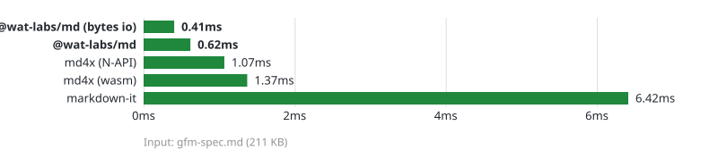

# @pierre/words

A fast markdown renderer written in WebAssembly Text (WAT).

- **Conformant**: Fully compliant to CommonMark `0.31.2` and GFM `0.29.0`.
- **Fast**: Up to 15× faster than
  [markdown-it](https://github.com/markdown-it/markdown-it), ahead of
  [md4x](https://github.com/unjs/md4x) native and wasm. See the
  [benchmark](./benchmark/README.md).
- **Lightweight**: 35 KB of gzipped Wasm, zero dependencies.
- **Two backends**: HTML, and ANSI for terminals.
- **YAML frontmatter**, parsed in Wasm and handed back as a plain object.

Try it in the [playground](https://md-playground.wat-labs.com).

<picture>
  <source media="(prefers-color-scheme: dark)" srcset="./benchmark/benchmark-dark.svg">
  
</picture>

## Why it is fast

- **HTML/ANSI rendering uses two passes, no tree.** Block analysis writes a flat
  record stream into linear memory; rendering walks it once. These output APIs
  do not allocate an AST or JavaScript node objects.
- **One arena.** Input, records, output, and per-block scratch are four regions
  of one linear memory that only ever grow — the renderer never calls an
  allocator.
- **SIMD scans.** Finding the next line ending, the next inline mark, or the
  next byte to escape reads 16 bytes at a time; inline marks are classified with
  two `i8x16.swizzle` table lookups.
- **Zero-copy I/O.** Pass a `Uint8Array` and get a `Uint8Array` view of Wasm
  memory back, skipping both the UTF-8 encode and the decode.
- **Hand-written WATs.** Every hot-path instruction is intentional; no C/Rust →
  wasm compiler tax.

## Usage

```bash
pnpm add @pierre/words
```

It runs in Node.js, browsers, and Cloudflare Workers; conditional exports pick
the right WebAssembly loader. The default JS entry point inlines its Wasm bytes,
so it also works during server rendering without filesystem access.

```js
import { renderToAnsi, renderToHtml } from '@pierre/words';

const html = renderToHtml('# Hello, **world**!');
// Uint8Array of <h1>Hello, <strong>world</strong>!</h1>

const [meta, body] = renderToHtml(
  '---\ntitle: Hello, world!\n---\n# Hello, **world**!',
  { frontmatter: true }
);
// meta -> { title: "Hello, world!" }

process.stdout.write(renderToAnsi('# Hello, **world**!'));
```

### Render Options

```ts
interface RenderOptions {
  /** Parse a leading `---` YAML block and return `[meta, html]` */
  frontmatter?: boolean;
  /** Wrap text at this column; `0` leaves wrapping to the terminal */
  width?: number;
}
```

## Development

| Command                                         | Purpose                                                     |
| ----------------------------------------------- | ----------------------------------------------------------- |
| `pnpm install`                                  | Install the dev dependencies                                |
| `moonx words:build`                             | Compile `src/*.wat` to `dist/md.wasm`                       |
| `moonx words:test`                              | Unit tests, fuzzing, and the grow suite                     |
| `moonx words:test-spec`                         | The CommonMark and GFM conformance suites                   |
| `moonx words:bench`                             | Benchmark against md4x and markdown-it                      |
| `moonx words:playground-dev --ignore-ci-checks` | Serve the [playground](./playground/index.mjs) on localhost |

Read [ARCHITECTURE.md](./ARCHITECTURE.md) before changing `src/`.

The [benchmark guide](./benchmark/README.md) includes a pinned Streamdown
comparison, quick and full runs, memory measurements, and the source data for
the docs charts. Start with `moon run words:bench-setup`, then
`moon run words:bench-quick`. Build-dependent benchmarks are opt-in in CI; use
`moonx words:bench-quick --ignore-ci-checks` in CI-marked shells.

For local parser optimization, start with
`moonx words:lab --ignore-ci-checks -- quick`. The
[optimization lab](./benchmark/README.md#local-parser-optimization) provides
isolated A/B comparisons, workload-specific kernels, named Wasm CPU profiles,
and diagnostic streaming-work counters without browser setup.

Large workloads are generated on demand. Run
`moon run words:bench-large -- 1000 16 /tmp/large.json` for the 8.53 MB case, or
choose a large example in the docs demo. See the
[large-fixture measurements](./benchmark/STREAMING.md#large-fixtures) and
[browser instructions](./benchmark/RENDERING.md#large-browser-examples).

## License

[Apache-2.0](./LICENSE.md). The imported renderer retains its original
[MIT license](./LICENSE-MIT); see [NOTICE.md](./NOTICE.md) for attribution.

## React and streaming

The default rendering path is Markdown → Wasm → HTML strings → native DOM. The
React entry point owns one opaque container and forwards updates to the same
framework-independent HTML renderer. It does not construct a JavaScript Markdown
tree or React elements for individual Markdown nodes or tokens.

The optional React entry point accepts a growing Markdown string:

```tsx
import { Markdown } from '@pierre/words/react';
import '@pierre/words/styles.css';

<Markdown isAnimating={status === 'streaming'} caret="block">
  {message.text}
</Markdown>;
```

`mode="streaming"` completes common unfinished emphasis, inline code, and links
in a display copy of the source. Incomplete images are hidden. Use
`parseIncompleteMarkdown={false}` to disable completion, or `mode="static"` for
normal Markdown semantics. This is not full Remend compatibility.

Append-only updates reuse completed top-level blocks and parse the open tail in
WAT. A newline-terminated blank line outside open containers is a safe boundary.
Lists, quotes, tables, and code stay mutable until the parser closes them.
Reference or footnote definitions trigger a full-document fallback, since they
can change earlier output. Edits and completion-option changes reset the cache.
A long open paragraph still requires parsing that whole paragraph.

Completed HTML and DOM stay in place. A checkpoint separates that prefix from
the mutable suffix; only suffix HTML is parsed by the browser and patched into
native nodes. Append updates preserve matching anchors and text nodes. Edits,
option changes, and definitions can require a full HTML update.

The direct HTML session is available without React or a browser:

```ts
import { createHtmlSession } from '@pierre/words';

const session = createHtmlSession();
const { html, stable, pending } = session.render('First paragraph.\n\nSecond');
session.render('First paragraph.\n\nSecond paragraph.');
```

`createHtmlRenderer()` and `createDomRenderer()` from `@pierre/words/html`
provide HTML formatting and native DOM streaming without React. The library does
not construct or export Markdown node trees.

| Prop                                    | Purpose                                                                                                                                                  |
| --------------------------------------- | -------------------------------------------------------------------------------------------------------------------------------------------------------- |
| `children`                              | Accumulated Markdown string                                                                                                                              |
| `animated`                              | Fade in newly appended text and code tokens: `true` or `{ animation: 'fadeIn', duration: 180 }` (milliseconds). Off by default; respects reduced motion. |
| `isAnimating`                           | Streaming UI state and incomplete-code controls                                                                                                          |
| `mode`                                  | `streaming` (default) or `static`                                                                                                                        |
| `parseIncompleteMarkdown`               | Complete common unfinished syntax (default `true`)                                                                                                       |
| `components`                            | HTML string hooks for generated elements; `inlineCode` handles inline code separately                                                                    |
| `plugins.code`                          | Synchronous HTML highlighter; unknown languages fall back to escaped text                                                                                |
| `plugins.renderers`                     | Custom fenced-code HTML render functions selected by language                                                                                            |
| `controls`                              | Enable code copy/download buttons, or configure `code.copy` and `code.download`                                                                          |
| `lineNumbers`                           | Show code line numbers (default `true`)                                                                                                                  |
| `caret`                                 | `block` or `circle`, shown while streaming                                                                                                               |
| `allowedElements`, `disallowedElements` | Mutually exclusive element filters                                                                                                                       |
| `unwrapDisallowed`                      | Keep children of filtered elements                                                                                                                       |
| `urlTransform`                          | Transform link/image URLs; transformed URLs are validated again                                                                                          |
| `onAnimationStart`, `onAnimationEnd`    | Streaming lifecycle callbacks                                                                                                                            |

HTML hooks receive a complete generated element string and return a string. This
replaces the earlier React-component override API. Hooks and plugins are trusted
application code; escape any additional untrusted text before inserting it.
Styling is opt-in through `styles.css` and `data-markdown` attributes.

```tsx
const components = {
  a: (html: string) => html.replace('<a ', '<a class="message-link" '),
};

<Markdown components={components}>{text}</Markdown>;
```

Incomplete links keep the same native anchor while their destination arrives;
`href` is omitted until the destination passes URL validation.

The React path omits raw HTML. It permits generated Markdown elements and
filters unsafe URL schemes, including `javascript:` and `data:`. External
HTTP(S) images are allowed; applications can use `urlTransform` or element
filters to restrict image sources. The low-level `renderToHtml()` API retains
its existing raw HTML behavior and must not be inserted into an untrusted page
without sanitization.

### Optional syntax highlighting

```tsx
import { createHighlightsPlugin } from '@pierre/words/highlights';
import pierreLight from '@pierre/highlights/themes/pierre-light';

const plugins = { code: createHighlightsPlugin({ theme: pierreLight }) };

<Markdown plugins={plugins}>{text}</Markdown>;
```

Completed fences use Highlights' direct Wasm-to-HTML API. Only the open fence
retains a `LiveTokenizer`; it serializes borrowed token records to HTML and
reuses earlier line strings. No per-token JavaScript objects are built. Closing,
replacing, or unmounting the fence releases the live tokenizer. Keep the plugin
object stable across renders. Both paths normalize CRLF and CR to LF.

React and Highlights are optional peers. Neither is loaded by the low-level
Markdown entry point. Math, Mermaid, CJK-specific extensions, arbitrary raw
HTML, and remark/rehype plugin compatibility are outside this initial React API.

### Fade in new tokens

```tsx
<Markdown
  isAnimating={status === 'streaming'}
  animated={{ animation: 'fadeIn', duration: 240 }}
>
  {message.text}
</Markdown>
```

Import `@pierre/words/styles.css` for the fade styles. The effect runs only
while `isAnimating` is true in streaming mode. Each delivered text chunk fades
together; earlier chunks retain their timing even when a word grows across
updates. Finished spans merge into plain text, so animation history stays small.
Static content and paused streams remain fully visible. Reduced motion and a
zero duration bypass animation bookkeeping.
