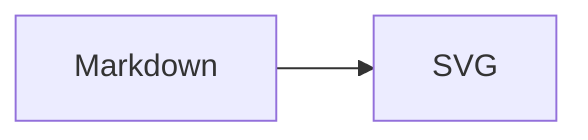

# Markdown extensions

## Math and CJK emphasis

Set `math: true` or `cjk: true` in `renderToHtml()`, `renderToAnsi()`, the
options to `session.render()`, or the options to either renderer factory. In
React, pass `math` or `cjk` as boolean props. Both default to `false`.

```ts
import { renderToHtml } from '@pierre/words';

const source =
  '**重要。**请阅读。\n\nThe result is $x^2$.\n\n$$\n\\frac{a}{b}\n$$';
const html = new TextDecoder().decode(
  renderToHtml(source, { math: true, cjk: true })
);
```

- Use `$...$` for inline TeX. Whitespace just inside the delimiters or a digit
  just after the closing `$` prevents a match. `$5 and $10` stays text.
- Use `$$...$$`, a multi-line `$$` block without blank lines, or a `math` code
  fence for display math. In a multi-line block, close with an unescaped `$$` at
  the end of the last line.
- Math produces SVG in HTML and TeX source in ANSI. During a stream, inline math
  stays text until its closing delimiter arrives. An open display block can show
  a partial formula.
- An app that renders no TeX can import `renderToHtml()`, `renderToAnsi()`, and
  `createHtmlSession()` from `@pierre/words/no-math`: a WebAssembly module about
  a third smaller, where the `math` option shows formulas as code.
- CJK mode lets `*`, `**`, and `~~` mark emphasis or strikethrough where
  punctuation meets Chinese, Japanese, or Korean text. `**重要。**请阅读。`
  renders as `<strong>重要。</strong>请阅读。` inside a paragraph. Prefer
  asterisks for emphasis in this case.

## Mermaid diagrams

Install `pele` and pass its synchronous `render` function to the plugin.

```ts
import { createMermaidPlugin } from '@pierre/words/mermaid';
import { render } from 'pele';

const plugins = { mermaid: createMermaidPlugin({ render }) };
```

Pass `plugins` to `Markdown`, `createHtmlRenderer`, or `createDomRenderer`. The
optional second argument to `createMermaidPlugin()` is the Pele options object.
Use a `mermaid` code fence in the Markdown source.

````md

````

During a stream, the plugin draws the complete lines of the open fence. It keeps
the last diagram if new lines fail to parse and hides the fence until a diagram
is available. A closed fence that fails to parse falls back to code. The diagram
sits in the code block frame. Its copy and download buttons use the Mermaid
source and stay disabled until the fence closes.

## Syntax highlighting

Install `@pierre/highlights`. Create the plugin once for stable theme options.

```ts
import pierreLight from '@pierre/highlights/themes/pierre-light';
import { createHighlightsPlugin } from '@pierre/words/highlights';

const plugins = { code: createHighlightsPlugin({ theme: pierreLight }) };
```

Pass the same `plugins` option as for Mermaid. Use a Highlights theme object.
The fence supplies the language. Unknown languages fall back to plain code.
During an active stream, an open fence reuses a live tokenizer.

The plugin uses the main `@pierre/highlights` entry, which loads all built-in
lexers. To add a language, call `registerLanguages([lexer])` from
`@pierre/highlights` with a lexer from `@pierre/wat-tools`. An open fence in
such a language renders again in full on each update.

## Custom code blocks

Use `plugins.renderers` to replace an entire fenced block. Use `plugins.code` to
highlight the contents inside `<code>`. These are synchronous HTML hooks. A
configured Mermaid plugin handles `mermaid` fences. For other fences, Words
selects the first matching custom renderer. If the selected renderer returns
`null`, Words uses the normal code block with syntax highlighting if configured.

```ts
import { escapeHtml } from '@pierre/words/html';
import type { PluginConfig } from '@pierre/words/html';

const plugins: PluginConfig = {
  renderers: [
    {
      language: ['note', 'aside'],
      render: ({ code }) => `<aside>${escapeHtml(code)}</aside>`,
    },
  ],
};
```

Each hook receives `{ code, language, meta, isIncomplete }`. `meta` is the rest
of the fence info string after the language, trimmed, or `''`. A custom renderer
can return `null` to use the code block or set `frame: true` to keep its header
and controls. Words caches the result of a closed block for the same language,
meta, and source. `configure(next)` on the HTML renderer clears this cache. The
DOM renderer clears it only when a renderer, plugin, or option value changes.

A custom `CodeHighlighterPlugin` returns escaped HTML for the contents of
`<code>` from `highlight(options)`, or `null` for plain code. Implement
`createSession()` with `highlight()` and `dispose()` to retain tokenizer state
for an open fence. Use the exported `CodeHighlightUpdate` type if the session
also implements `highlightLines()` for incremental DOM patches.
